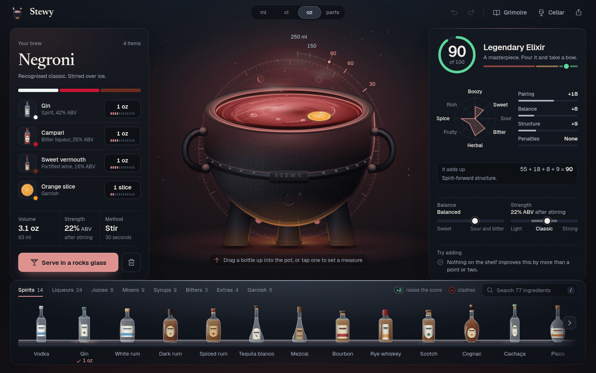
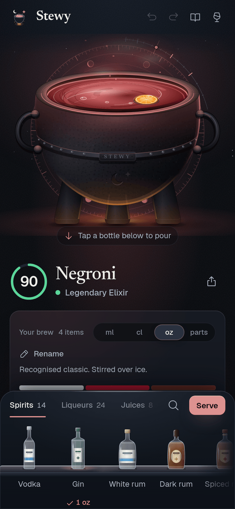

<p align="center">
  
</p>

# Stewy

An enchanted cocktail cauldron. Drag bottles into a cast-iron pot, watch the brew
light the room, and see exactly how the score is built.

**Live:** [stewy.pages.dev](https://stewy.pages.dev)

<p align="center">
  
</p>

## What it does

- **The cauldron.** A cast-iron pot in a room lit by whatever is in it. The level
  follows the pour (90 ml already reads as a full drink), a ring of moon phases
  behind the pot doubles as a fill gauge, and every pour lands with a droplet,
  a ripple and a few sparks. Garnishes float on the surface.
- **The back bar.** 77 ingredients as real bottles, jars and carafes on a lit
  shelf, in tabs, with search on `/`. Each bottle tells you what it would do:
  a green `+N` when it would raise the score, a red dot only when it would
  actually clash (curdle, muddy). Drag one into the pot, or tap it to pour.
- **The pour dial.** A hardware-style dial with a 64-segment LED ring. Drag it,
  scroll it, use the arrow keys (Shift for fine steps) or pick a preset. It shows
  the score you would get at that measure, and why.
- **An honest score.** 0 to 100 with a verdict, and the arithmetic in plain
  sight: `55 + 18 + 8 + 9 = 90`. Pairing, balance, structure and penalties each
  have a bar, an eight-axis flavour radar shows the shape of the drink, and
  meters place it between sweet and sour, light and strong. "Try adding" only
  appears when something helps by 3 points or more.
- **It knows the classics.** 55 classics, each scoring between 80 and 92. The engine
  recognises them in your pot and understands drink shapes (spirit-forward,
  sour, highball, dessert), so a Negroni and a Mojito are judged on their own terms.
- **The serve card.** Glassware, ice and garnish are inferred from what you
  brewed. You get the measures, numbered method steps, a tasting note and the
  strength after dilution, then save it to the Cellar, share a link or copy the recipe.
- **The Grimoire.** All 55 classics as an illustrated index, filterable by
  method and style, ready to load into the pot.
- **The Cellar.** Your saved brews, on this device only.
- **Share links.** A brew is encoded in the link itself. No accounts, no server.
- **Measures.** ml, cl, oz or parts across the whole app. Bitters count in
  dashes and garnishes in pieces. Measures can be scrubbed directly on the recipe card.
- **Undo everything.** Full undo and redo history, plus undo on every removal toast.
- **Installable.** A PWA that works offline after the first visit.
- **Accessible.** Every drag has a tap or keyboard equivalent, score changes are
  announced to screen readers, and reduced motion is respected throughout.

<p align="center">
  
</p>

### Keyboard

| Key | Action |
| --- | --- |
| `Ctrl/Cmd + Z` | Undo |
| `Ctrl/Cmd + Shift + Z`, `Ctrl + Y` | Redo |
| `/` | Search the shelf |
| `G` | Open the Grimoire |
| `C` | Open the Cellar |
| `S` | Serve |
| `Esc` | Close the top sheet |

## How the score works

Every ingredient carries a flavour profile across 15 dimensions (boozy, sweet,
sour, bitter, herbal, citrus, smoky and so on). The engine builds a
volume-weighted profile of the whole drink and starts from a base of 55. Then:

- **Pairing** scores every pair of flavours against an affinity matrix
  (sweet with sour is great, smoke with cream is not).
- **Balance** rewards a sweet and sour axis that sits near the middle.
- **Structure** rewards recognisable shapes: a spirit-forward stirred drink,
  a sour, a highball, a dessert drink. A brew with no shape loses points here.
- **Penalties** cover the things no bartender would pour: too sweet or too sour
  with no counterweight, one-note drinks, crowded pots of eight spirits, and real
  clashes such as dairy with citrus, which curdles at any dilution.

The calibration is pinned by tests in [`calibration.test.ts`](src/lib/calibration.test.ts):
every classic scores 80 or more, a suite of known clashes stays at 55 or less,
and random brews have a median below 70, so a high score means something.

## Tech

- **React 19, TypeScript 6, Vite 8.** The engine in [`src/lib`](src/lib)
  (harmony, coach, serve, share, colour, units) is pure functions with no DOM,
  fully separated from the UI.
- **[Motion](https://motion.dev)** for spring-based layout and sheet animation,
  **[Phosphor](https://phosphoricons.com)** for interface icons. All bottles,
  glassware, garnishes and the cauldron are hand-built parametric SVG.
- **Geist** for the interface and **Newsreader** for names, self-hosted through
  Fontsource, so the app makes no third-party requests.
- **Vitest** (node and jsdom projects) and **ESLint 9**.
- **vite-plugin-pwa** for the service worker.

The design system (colour, type, spacing, motion, every component) is
documented in [DESIGN.md](DESIGN.md), including the architecture map.

## Run it

```bash
npm install
npm run dev        # http://localhost:5173
npm test           # unit and component tests
npm run lint
```

Production build (type-checks first, outputs `dist/`):

```bash
npm run build
npm run preview    # serve the built bundle locally
```

## Deploy to Cloudflare Pages

1. In the Cloudflare dashboard, open **Workers & Pages**, then **Create**,
   **Pages** and **Connect to Git**.
2. Pick this repo. Framework preset **Vite**, build command `npm run build`,
   build output directory `dist`.
3. Deploy.

[`public/_headers`](public/_headers) ships with the build and adds security
headers (CSP, `X-Frame-Options`, `nosniff`, `Referrer-Policy`) plus immutable
caching for Vite's content-hashed assets.
