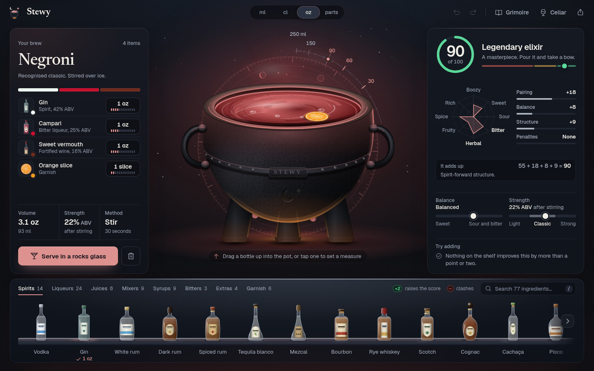
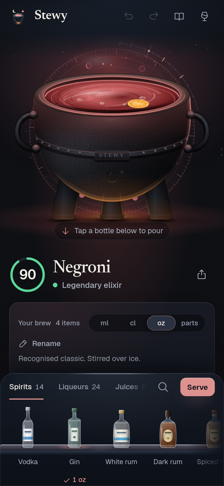

<p align="center">
  
</p>

# Stewy

An enchanted cocktail cauldron. Drag bottles into a cast-iron pot, watch the brew
light the room, and see exactly how the score is built.

**Live:** [stewy.pages.dev](https://stewy.pages.dev)

<p align="center">
  
</p>

## What it does

- **The cauldron.** A cast-iron pot in a room lit by whatever is in it. The level
  follows the pour (90 ml already reads as a full drink), a ring of moon phases
  behind the pot doubles as a fill gauge, and every pour lands with a droplet,
  a ripple and a few sparks. Garnishes float on the surface.
- **The back bar.** 77 ingredients as real bottles, jars and carafes on a lit
  shelf, in tabs, with search on `/`. Each bottle tells you what it would do:
  a green `+N` when it would raise the score by 2 or more, a red dot only when it would
  actually clash (curdle, muddy). Drag one into the pot, or tap it to pour.
- **The pour dial.** A hardware-style dial with a 64-segment LED ring. Drag it,
  scroll it, use the arrow keys (Shift for fine steps) or pick a preset. It shows
  the score you would get at that measure, and why.
- **An honest score.** 0 to 100 with a verdict, and the arithmetic in plain
  sight: `55 + 18 + 8 + 9 = 90`. Pairing, balance, structure and penalties each
  have a bar, an eight-axis flavour radar shows the shape of the drink, and
  meters place it between sweet and sour, light and strong. "Try adding" only
  appears when something helps by 3 points or more.
- **It knows the classics.** 56 classics, each scoring 80 or more. The engine
  recognises them in your pot and understands drink shapes (spirit-forward,
  sour, highball, dessert), so a Negroni and a Mojito are judged on their own terms.
- **The serve card.** Glassware, ice and garnish are inferred from what you
  brewed (a Ramos Gin Fizz is strained up, with no ice). You get the measures,
  numbered method steps, a tasting note and the strength after dilution, then save
  it to the Cellar, share a link or copy the recipe. A brew that clashes hard gets
  one plain line naming its fault instead of praise.
- **The Grimoire.** All 56 classics as an illustrated index, filterable by
  method and style, ready to load into the pot.
- **The Cellar.** Your saved brews, on this device only.
- **Share links.** A brew is encoded in the link itself. No accounts, no server.
- **Measures.** ml, cl, oz or parts across the whole app. Bitters count in
  dashes and garnishes in pieces. Measures can be scrubbed directly on the recipe card.
- **Undo everything.** Full undo and redo history, plus undo on every removal toast.
- **Any screen.** A three-column desktop, a stacked layout for tall tablets and
  portrait monitors (5:6 and taller), a tablet layout, a phone layout with a
  fixed dock for the shelf, a phone-landscape layout, and a scaled-up interface
  on big screens, with its own zoom ladder for portrait monitors. Touch targets
  are at least 44px on touch devices.
- **Installable.** A PWA that works offline after the first visit.
- **Accessible.** Every drag has a tap or keyboard equivalent, a skip link leads
  the tab order, sheets trap focus, score changes and measure steps are announced to
  screen readers, text meets 4.5:1 contrast (apart from the decorative engraving on
  the pot) and reduced motion is respected throughout.

<p align="center">
  
</p>

### Keyboard

| Key | Action |
| --- | --- |
| `Ctrl/Cmd + Z` | Undo |
| `Ctrl/Cmd + Shift + Z`, `Ctrl + Y` | Redo |
| `/` | Search the shelf |
| `Tab` | First stop is "Skip to main content" |
| `G` | Open the Grimoire |
| `C` | Open the Cellar |
| `S` | Serve |
| `Esc` | Close the top sheet (in the Grimoire on a phone, step back to the index first) |
| Arrow keys on a measure | Step the amount; `Enter` opens the pour dial |

## How the score works

Every ingredient carries a flavour profile across 15 dimensions (boozy, sweet,
sour, bitter, herbal, citrus, smoky and so on). The engine builds a
volume-weighted profile of the whole drink and starts from a base of 55. Then:

- **Pairing** scores every pair of flavours against an affinity matrix
  (sweet with sour is great, smoke with cream is not).
- **Balance** rewards a sweet and sour axis that sits near the middle.
- **Structure** rewards recognisable shapes: a spirit-forward stirred drink,
  a sour, a highball, a dessert drink. A brew with no shape loses points here.
- **Penalties** cover the things no bartender would pour: too sweet or too sour
  with no counterweight, one-note drinks, pots crowded past six ingredients, and real
  clashes such as dairy with citrus, which curdles at any dilution (the one exception is a Ramos Gin Fizz, where egg white, syrup and soda carry the cream).

Nothing in the score is a cliff on an amount. Every amount gate (how much of the
pot is spirit, mixer, acid, cream and so on) fades in over a band, so the hard
steps are gone, but a half millilitre can still move a small pot a long way. The pinned sweeps
cap the step per 0.5 ml at 6 points for the classics, 7 for real-size random pots (30 ml or more of other
flavoured liquid) and 13 for small ones (10 to 30 ml), and at 9, 13, 16 and 19 for cream, milk or Irish cream
meeting acid, by how much other liquid carries flavour (90, 60, 30 or 10 ml or
more). Each cap is the worst step measured plus a point, and under 10 ml of other liquid nothing is bounded. The steepest steps left are the first millilitre of acid into a small
creamy or coffee drink, where half a millilitre is a real share of the drink.
Count gates (how many ingredients, strong ones or base spirits) stay hard steps by design.

The words follow the same engine. Praise needs a score of 80 or more and no bad
tip. The curdle tip, the tasting note and the coach all key off the engine's own
curdle (5 points or more), the coffee and acid tip uses the same 5-point line,
and neither the coach nor the shelf offers more dairy to a curdled brew.

The calibration is pinned by tests in [`calibration.test.ts`](src/lib/calibration.test.ts):
every classic scores 80 or more, a suite of known clashes stays at 55 or less,
the step bounds above hold, and random brews have a median below 70, so a high
score means something.

## Tech

- **React 19, TypeScript 6, Vite 8.** The engine in [`src/lib`](src/lib)
  (harmony, coach, serve, share, colour, units) is pure functions with no DOM,
  fully separated from the UI.
- **[Motion](https://motion.dev)** for spring-based layout and sheet animation,
  **[Phosphor](https://phosphoricons.com)** for interface icons. All bottles,
  glassware, garnishes and the cauldron are hand-built parametric SVG.
- **Geist** for the interface and **Newsreader** for names, self-hosted through
  Fontsource, so the app makes no third-party requests.
- **Vitest** (node and jsdom projects), **Playwright Test** for the browser suite, and **ESLint 9**.
- **vite-plugin-pwa** for the service worker.

**Browsers.** The build target is Vite's `baseline-widely-available` (Chrome and
Edge 111, Firefox 114, Safari and iOS 16.4), so Safari and iOS 16.4 is the floor.
Safari before 26.4 implements CSS `zoom` the old way, so there the big-screen zoom
is switched off and the interface stays unscaled (see
[`cqUnits.ts`](src/lib/cqUnits.ts)).

The design system (colour, type, spacing, motion, every component) is
documented in [DESIGN.md](DESIGN.md), including the architecture map.

## Run it

```bash
npm install
npm run dev        # http://localhost:5173
npm test           # unit and component tests (Vitest)
npm run lint
```

### End-to-end tests

The browser suite uses Playwright Test and lives in `e2e/`. It builds the production bundle into `dist-e2e` and serves it on port 4317, then drives the real app: shelf and pour, the dial, the recipe card, analysis, Serve, the Grimoire, the Cellar, share links, undo, the phone and tablet layouts, reduced motion, big-screen zoom, and a check that the console stays silent. `E2E_PORT` and `E2E_OUTDIR` change the port and the output folder, so runs and worktrees can build and serve side by side.

```bash
npm run test:e2e                                          # Chromium on this machine
npm run test:e2e:webkit                                   # desktop WebKit in the official Playwright container
npm run test:e2e:mobile                                   # iPhone and iPad projects in WebKit, same container
npm run test:e2e:all                                      # all three, one after the other
npx playwright test --project=chromium e2e/zoom.spec.ts   # one spec
E2E_PORT=4400 E2E_OUTDIR=dist-e2e-b npm run test:e2e      # a second run beside the first
```

`test:e2e:mobile` runs five projects: iPhone 15, iPhone SE (3rd gen), iPhone 15 landscape, iPad Pro 11 and iPad Pro 11 landscape. They run only the specs that have a touch version, with taps in place of clicks and hotkeys. Tags sort the rest: `@desktop` is a desktop size sweep or mouse and hover geometry, `@emulated` is a phone or desktop size that a desktop project fakes with `test.use`, and `@device` is the real-device twin of a pair (and all of `touch.spec.ts`). The mobile projects skip the first two, the desktop projects skip the third.

The app is tested in Chromium and WebKit. The WebKit runs use Playwright's Linux WebKit build, which is close to Safari but is not macOS Safari or iOS Safari. It has no real safe-area insets, no collapsing toolbar and no on-screen keyboard (the keyboard lift is tested against a stand-in visual viewport), so a real-device check is still worth doing before a release. Mobile WebKit has no mouse wheel and Playwright cannot swipe, so the scroll lock on touch is checked as the lock state plus `scrollY`, not as a drag.

WebKit does not run on every Linux host, so `test:e2e:webkit` and `test:e2e:mobile` start the official image `mcr.microsoft.com/playwright:v1.64.0-noble` with podman (swap in docker if you prefer; the flags are the same) and mount the repo into it. Pull the image once with `podman pull mcr.microsoft.com/playwright:v1.64.0-noble`. Chromium needs the matching browser from `npx playwright install chromium`. Reports and traces land in `test-results/` and `playwright-report/`, which git ignores.

Production build (type-checks first, outputs `dist/`):

```bash
npm run build
npm run preview    # serve the built bundle locally
```

## Deploy to Cloudflare Pages

1. In the Cloudflare dashboard, open **Workers & Pages**, then **Create**,
   **Pages** and **Connect to Git**.
2. Pick this repo. Framework preset **Vite**, build command `npm run build`,
   build output directory `dist`.
3. Deploy.

[`public/_headers`](public/_headers) ships with the build and adds security
headers (CSP, `X-Frame-Options`, `nosniff`, `Referrer-Policy`) plus immutable
caching for Vite's content-hashed assets.
